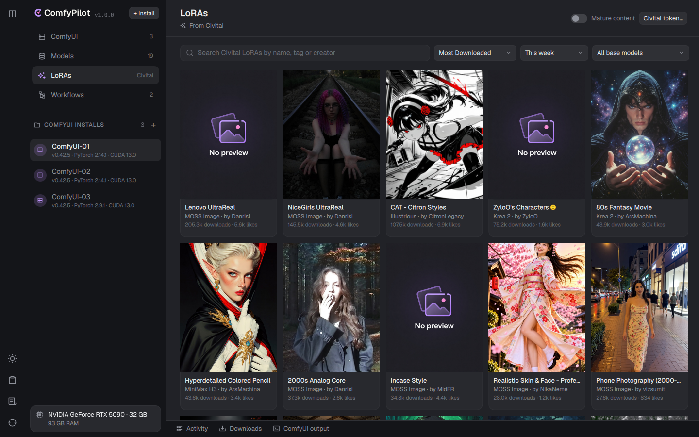
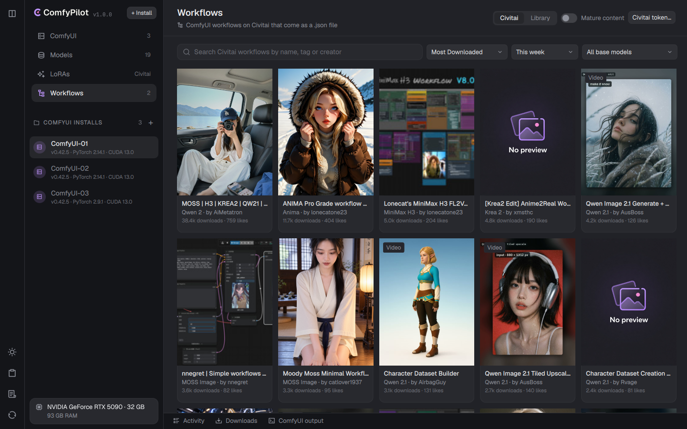
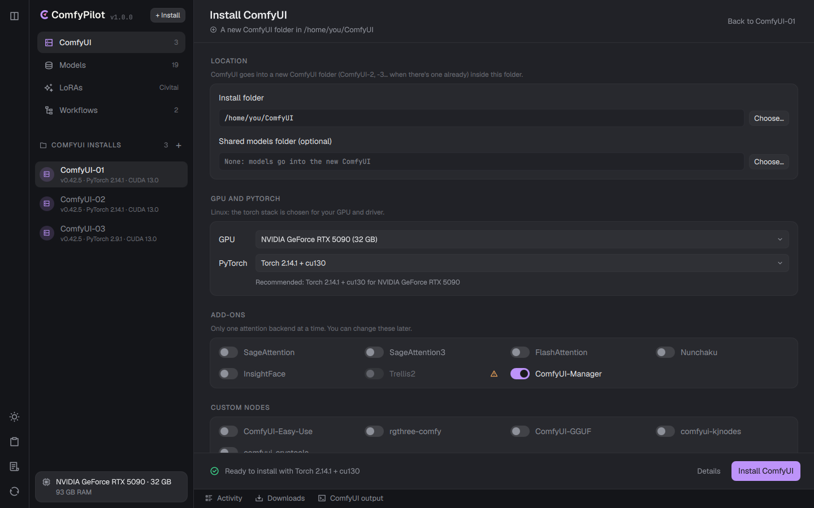
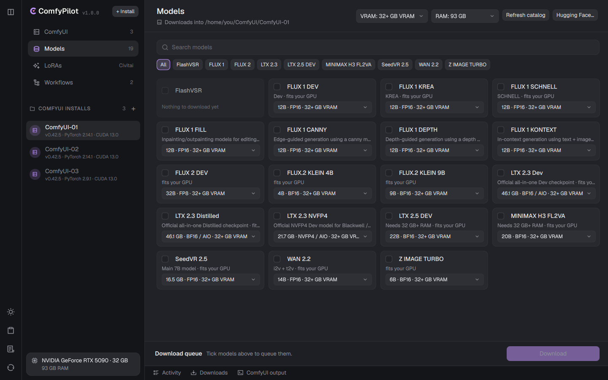
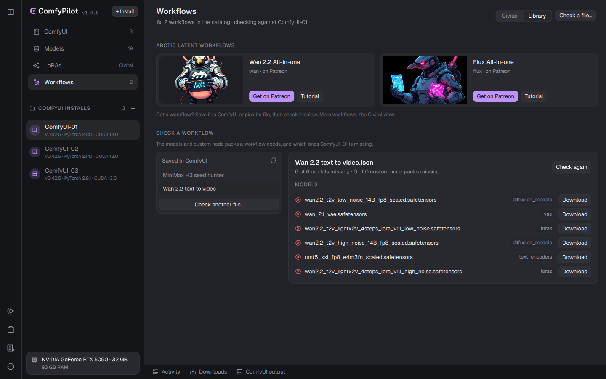
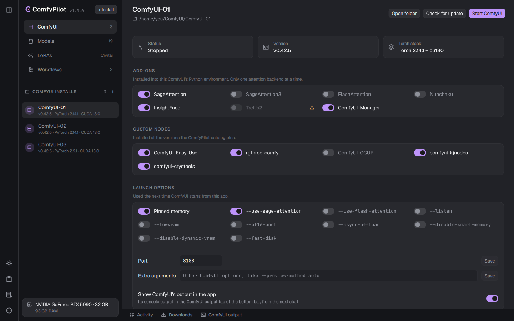

<p align="center">
  <picture>
    <source media="(prefers-color-scheme: dark)" srcset="app/qml/assets/logo.svg" />
    
  </picture>
</p>

<p align="center">
  <b>Install, run and keep ComfyUI up to date, the easy way.</b><br />
  A native desktop app for Linux and Windows.
</p>

<p align="center">
  <a href="https://github.com/ArcticLatent/ComfyPilot/releases/latest"></a>
  
  <a href="LICENSE"></a>
</p>

<p align="center">
  <a href="docs/screenshots/comfy-dark.png"></a><a href="docs/screenshots/comfy-light.png"></a>
</p>

ComfyPilot sets up [ComfyUI](https://github.com/Comfy-Org/ComfyUI) with the right PyTorch
build for your graphics card, keeps several installs side by side, and gets you the models,
LoRAs and workflows you need. No terminal, no guessing which CUDA wheel goes with which driver.

ComfyPilot is the new name of **Arctic ComfyUI Helper**. Installing it brings your settings,
saved tokens and ComfyUI installs over automatically.

## Features

**ComfyUI, set up right**

- **The PyTorch build that fits your GPU.** ComfyPilot detects your graphics card and driver
  and picks the stack: CUDA 13 on NVIDIA RTX 20-series and newer, ROCm on AMD, XPU on Intel
  Arc. You can still choose another one.
- **Add-ons in one click:** SageAttention, FlashAttention, Nunchaku, InsightFace, Trellis2 and
  ComfyUI's built-in ComfyUI-Manager, with the compatibility rules handled for you.
- **Popular custom nodes**, installed at versions that are known to work together.
- **Safe updates.** The PyTorch stack is pinned per install, so updating ComfyUI never swaps
  it out, and a snapshot of your custom nodes is taken before every update.
- **As many installs as you like**, each with its own version, stack and status at a glance.

**Running ComfyUI**

- Start, stop and restart from the app or the system tray.
- Launch options that follow ComfyUI's current memory model; only options your ComfyUI
  version understands are shown.
- ComfyUI's output in a built-in console, with colours and filters for errors and warnings.

**Models, LoRAs and workflows**

- A curated model catalog with the variants that fit your VRAM and RAM, downloaded into the
  right folders. Large Hugging Face files download fast via Xet.
- Browse Civitai LoRAs and workflows, with previews (videos too) and one-click downloads.
- **Workflow check:** open any workflow and see which models and custom nodes your install is
  missing, then download or install them.
- Hugging Face and Civitai tokens are kept in your system keychain, with step-by-step help to
  create them.

**And also**

- Light and dark themes.
- Updates itself: the Windows installer, or the right .deb, .rpm or Arch package on Linux.

## Screenshots

<sub>Click a screenshot to see it full size.</sub>

### Browse LoRAs on Civitai

Search, sort and filter Civitai's LoRAs by base model, see previews (videos play in the
detail view) and download straight into the right folder of your ComfyUI.

<p align="center">
  <a href="docs/screenshots/loras-dark.png"></a>
</p>

### Find workflows

Browse ComfyUI workflows shared on Civitai, download one, and ComfyPilot checks what it
needs.

<p align="center">
  <a href="docs/screenshots/civitai-workflows-dark.png"></a>
</p>

### And the rest

<table>
  <tr>
    <td width="50%">
      <a href="docs/screenshots/install-dark.png"></a>
      <p align="center"><sub>A new install, with the PyTorch build picked for the GPU</sub></p>
    </td>
    <td width="50%">
      <a href="docs/screenshots/models-dark.png"></a>
      <p align="center"><sub>Models, with variants for your VRAM</sub></p>
    </td>
  </tr>
  <tr>
    <td width="50%">
      <a href="docs/screenshots/workflows-dark.png"></a>
      <p align="center"><sub>Checking what a workflow needs</sub></p>
    </td>
    <td width="50%">
      <a href="docs/screenshots/comfy-dark.png"></a>
      <p align="center"><sub>The dark theme (the light one is at the top)</sub></p>
    </td>
  </tr>
</table>

## Download

Get the file for your system from the
[latest release](https://github.com/ArcticLatent/ComfyPilot/releases/latest).

| System | File | Install |
| --- | --- | --- |
| **Windows** 10 (1809) or 11 | `ComfyPilot-Setup-<version>.exe` | Run it. Installs for your user, no administrator rights needed. |
| **Debian** 13+, **Ubuntu** 25.04+ and derivatives | `comfypilot_<version>-1_amd64.deb` | `sudo apt install ./comfypilot_*.deb` |
| **Fedora** 43+ | `comfypilot-<version>-1.fc43.x86_64.rpm` | `sudo dnf install ./comfypilot-*.rpm` |
| **Arch Linux**, CachyOS, EndeavourOS, Manjaro… | `comfypilot-<version>-1-x86_64.pkg.tar.zst` | `sudo pacman -U comfypilot-*.pkg.tar.zst` |

After that, ComfyPilot keeps itself up to date: it tells you when a new version is out and
installs it for you.

**What you need:** a 64-bit system and, for image and video generation, an NVIDIA (RTX 20-series
or newer recommended), AMD or Intel Arc graphics card with a current driver. ComfyPilot checks
for the system tools ComfyUI needs and installs missing ones through your package manager after
asking.

## Coming from Arctic ComfyUI Helper?

Install ComfyPilot and open it. Your settings, Civitai token and list of ComfyUI installs are
copied over on the first start, and your ComfyUI installs keep working as they are. On Linux,
the ComfyPilot package replaces the old `arctic-comfyui-helper` package.

## Building from source

ComfyPilot is written in Rust with a Qt Quick (Qt 6.8+) interface via
[cxx-qt](https://github.com/KDAB/cxx-qt).

```bash
# Needs Rust 1.89+, Qt 6.8+ (qmake6 on PATH) and the D-Bus headers.
cargo run --manifest-path app/Cargo.toml
```

The catalog settings are compiled in from `ARCTIC_SUPABASE_URL` and
`ARCTIC_SUPABASE_PUBLISHABLE_KEY` (see `.env.sample`); `scripts/dev.sh` reads them from `.env`.
Packaging and releases are described in [docs/releasing.md](docs/releasing.md).

## License

[Apache-2.0](LICENSE)
